# MAPGEN Studio by ly — руководство

MAPGEN Studio делает новые карты Quake II двумя путями.

- **Из готовой карты** — переделывает её: прокладывает проходы в скале, переносит комнаты из другой карты,
  заливает низины водой, лавой или кислотой, меняет отделку, переставляет предметы. Карта-основа при этом остаётся
  на месте, новая карта кладётся рядом.
- **С нуля** — строит новую карту по параметрам: на сколько игроков она, сколько в ней уровней, лифтов, джампадов
  и воды, какое оружие, какие приёмы игры и в каком стиле. Глава «Новая карта с нуля» — ниже.

В обоих случаях студия проверяет, что по новой карте можно пройти, что она освещена и что в ней ничего не сломано.

Все снимки в этом руководстве сделаны самой программой из той версии, к которой оно приложено.

## Что нужно

- Windows 10 или 11, 64 бита.
- Quake II с папкой `baseq2` — любой клиент: из неё берутся текстуры, на ней же запускается игра для обложек.
- Python 3.10 или новее — для проверок готовой карты. Если его нет, программа сама предложит его установить
  (кнопка «Установить Python» скачает официальный установщик с python.org и поставит его только для вас, без прав
  администратора) или указать путь к уже установленному («Указать путь к Python…»). Без Python карта соберётся,
  но проверки будут пропущены.
- Карты-основы: программа не содержит карт. Любой файл карты Quake II (`.bsp`) из вашей игры можно добавить
  как основу прямо из программы.

## Первый запуск

Пока студия загружается, на экране окно загрузки: процент готовности и что делается сейчас (оформление окон,
чтение библиотеки карт, обложка последней карты, поиск Python и игры, загрузка студии). Процент считается по тому,
сколько каждый шаг занял при прошлом запуске, поэтому на медленном компьютере или диске полоска идёт так, как
загружается именно он. Первый запуск после установки дольше обычного.

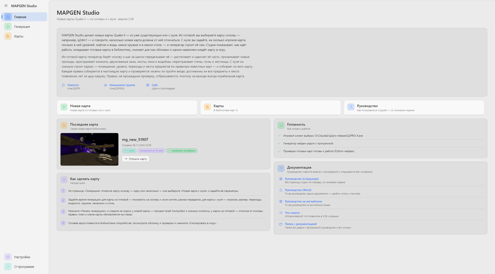

Слева — меню: **Главная**, **Генерация**, **Карты**, внизу **Настройки** и **О программе**. У каждого раздела
свой цветной значок; раздел под мышью подсвечивается, открытый выделен своим цветом и полоской слева. Кнопка ☰
вверху сворачивает меню до одних значков и разворачивает обратно.

На главной странице:

- **Пара абзацев о студии и генераторе** — что они делают и почему на выходе всегда играбельная карта.
- **Ссылки сообщества** под ними: **Новости** (канал в Telegram, https://t.me/Q2RTX), **Комьюнити группа** (группа в
  Telegram, https://t.me/Q2PROX) и **Сайт** (http://q2pro-x.com/mapgen); открываются в браузере.
- **Три большие кнопки**: «Новая карта» — к генерации, «Карты» — к библиотеке (на кнопке видно, сколько в ней
  карт), «Руководство» — открывает это руководство.
- **Последняя карта** — самая новая карта библиотеки: обложка, основа, итог проверок и кнопка «Открыть карту».
  Пока идёт генерация, здесь вместо неё — что делается сейчас и кнопка «Открыть генерацию».
- **Готовность** — всё ли настроено: игровой клиент (папка с игрой, где лежит `baseq2`), генератор (папка `engine`
  рядом с программой; если её нет, сборка повреждена), Python и проверки готовых карт. Если чего-то не хватает, тут же
  кнопка, чтобы это исправить: «Открыть настройки», «Установить Python», «Указать путь к Python…».
- **Документация** — руководство ставится вместе с программой (папка `doc` рядом с ней) и открывается без
  интернета: в браузере, в Word, на английском; «Что нового» — история версий; «Папка с документацией».
- **Как сделать карту** — четыре шага.

**Строка генерации.** Пока идёт генерация, над любой страницей, кроме страницы самой генерации, видна строка:
название карты и основа, что делается сейчас и сколько осталось, отличие от основы, сколько правок принято и
сколько сборок сделано, полоска и кнопка «Открыть генерацию» (щелчок по строке делает то же). Когда генерация
закончится, строка остаётся, пока вы не заглянете на её страницу.

## Генерация

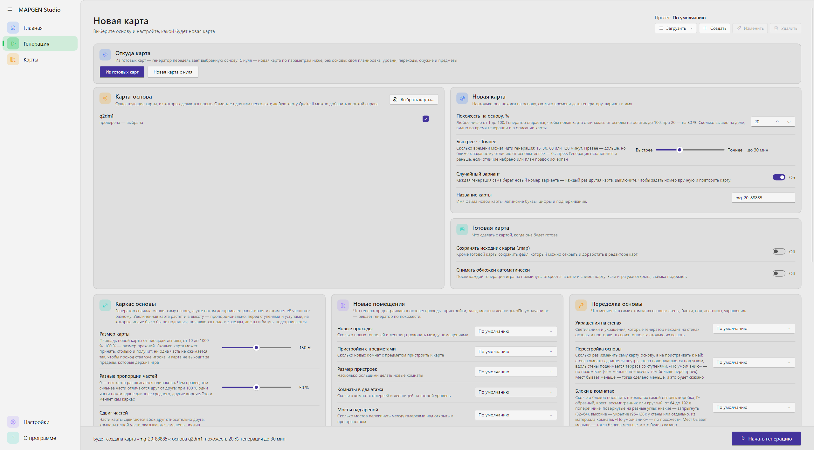

Страница разложена по карточкам в колонки — столько, сколько помещается по ширине окна: на узком одна, на
широком мониторе три; карточки делятся по колонкам так, чтобы колонки кончались примерно вровень. Вверху —
**Карта-основа**, **Новая карта** (похожесть на основу, время генерации, номер варианта, название) и **Готовая карта**
(сохранять ли исходник, снимать ли обложки автоматически). Ниже — параметры генерации, карточками по группам:
**Каркас основы**, **Новые помещения**, **Переделка основы**, **Вода, кислота, лава**, **Разрушения** и **Что можно
менять**. Внизу страницы всегда видна строка «Будет создана карта … : основа …, похожесть …, генерация до … мин» и
кнопка **«Начать генерацию»** — где бы вы ни были на странице.

**Пресеты.** Справа от заголовка страницы — какой пресет стоит сейчас и кнопки **«Загрузить»**, **«Создать»**,
**«Изменить»**, **«Удалить»**. Пресет — сохранённый набор параметров страницы. «Загрузить» открывает меню по
категориям: заводские пресеты (их нельзя изменить или удалить) и ваши. «Создать» сохраняет текущие параметры под
своим именем и в своей категории. У карты из готовой и у новой карты с нуля — свои наборы.

### Карта-основа

Отметьте одну или несколько карт. Кнопка «Выбрать карты…» добавляет любой файл карты Quake II с диска — он
копируется к программе и дальше всегда есть в списке. У каждой карты написано, проверена ли она уже
генератором или это первая проба.

Если отмечено несколько карт, выберите, что из них сделать:

- **По карте из каждой** — каждая отмеченная карта станет основой своей новой карты, по очереди.
- **Одну карту из нескольких** — первая отмеченная карта будет основой, а из остальных генератор берёт
  комнаты и переносит их в скалу целиком, со стенами, потолком, светильниками и украшениями.

### Похожесть на основу и номер варианта

- **Похожесть на основу, %** — насколько новая карта должна остаться похожей на старую. 90 — почти та же
  карта с небольшими правками; 10 — генератор меняет всё, что может. Любое число от 1 до 100.
- **Номер варианта** — число, от которого зависит, какие именно правки будут выбраны. Та же основа, та же
  похожесть и тот же номер дают ту же карту; другой номер — другую.
- **Название карты** — латинскими буквами и цифрами. Программа предлагает своё: `mg_` + похожесть +
  номер варианта.

### Каркас основы

Прежде чем что-то пристраивать, генератор может изменить саму основу:

- **Размер** — площадь новой карты от площади основы, от 10 до 1000 %. Увеличенная карта растёт и в высоту, сохраняя
  пропорции: залы становятся не только шире, но и выше. Перед ступенями и уступами, на которые иначе было бы не
  подняться, появляются пологие заезды или лесенки; щели в решётках, куда раньше нельзя было провалиться, перекрыты;
  лифты и джампады подстраиваются под новую высоту. Если при полном росте высоты где-то нельзя пройти, генератор
  пробует чуть меньший рост, пока карта не станет проходимой целиком. Уменьшенная карта высоту не теряет.
  Предметы и точки появления игроков остаются на своей высоте над полом. Свет на большой карте рассчитывается с
  шагом, подобранным под её размер, — карта, увеличенная в несколько раз, не выйдет тёмной.
- **Разброс** — насколько по-разному растягиваются части основы.
- **Сдвиг** — насколько части сдвигаются вбок друг относительно друга.
- **Поворот** — повернуть или отразить основу целиком.
- **Высота потолков** — сверх пропорциональной высоты: всё, что выше самого высокого места, где может стоять игрок,
  поднимается ещё. 100 % — пропорционально размеру карты. На очень большой карте потолкам может не хватить места —
  координаты игры ограничены; тогда они поднимаются настолько, насколько позволяет игра, и в журнале хода появляется
  строка вида «Потолки подняты до 134 % из заказанных 200 %: выше не позволяют координаты игры».

### Размах переделок

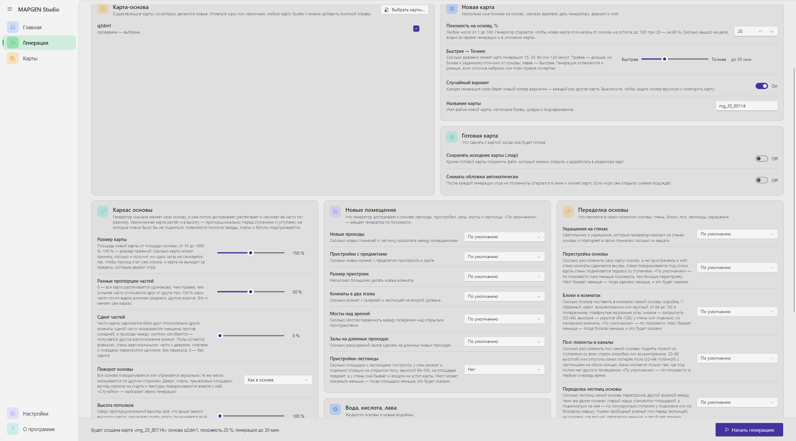

Сколько и чего строить, задают карточки под основой: **Новые помещения** (проходы, пристройки, залы, мосты,
лестницы), **Переделка основы** (стены, блоки, пол, лестницы, украшения), **Вода, кислота, лава** и **Разрушения**.
У каждой настройки есть значение «По умолчанию» — тогда решает генератор, исходя из похожести. Остальные
значения — ваш прямой заказ:

- **Новые проходы** — сколько новых тоннелей и лестниц пробить в скале между комнатами.
- **Пристройки с предметами** и **Размер пристроек** — сколько комнат-пристроек с оружием или бронёй добавить
  и какого размера (небольшие, средние, большие, залы).
- **Комнаты в два этажа** — сколько комнат получат галерею и лестницу на второй уровень.
- **Мосты над ареной** — сколько мостов перекинуть над открытым пространством.
- **Залы на длинных проходах**.
- **Жидкости** — заменить жидкости основы другими: воду лавой, лаву водой, кислоту лавой и так далее, или
  перемешать. Меняется и вид, и свойства: в лаве горят, в кислоте разъедает, в воде плавают.
- **Украшения на стенах** — генератор находит на стенах основы её светильники и повторяющиеся украшения и
  вешает такие же в своих тоннелях: без украшений, мало, много, очень много.
- **Новая вода**, **Новая кислота**, **Новая лава** — три ползунка. По умолчанию решает генератор; 0 — этой
  жидкости не добавлять совсем; 100 — залить ею все комнаты, где это можно. Генератор заливает только комнаты с
  ровным полом, под которым нет другой комнаты, и не отрезает ни предметы, ни проходы. Лаву и кислоту он не
  кладёт рядом с точками появления; проходы между комнатами заливает только водой.
- **Пристройки-лестницы** — от «Нет» до 10. Генератор строит новые площадки на высоте 96–192 с лестницей к ним:
  вдоль стен комнат и отдельно стоящие на открытом полу (таких не больше половины). На площадке оказывается предмет
  из этой части карты, а площадка у стены бывает и входом на уступ карты. Места он ищет на любой основе сам — нужен ровный пол, свободное место вокруг и над головой;
  если мест меньше, чем заказано, площадок будет меньше, и это сказано в описании карты.
- **Перестройка основы** — сколько раз изменить саму карту-основу, а не пристраивать к ней: стена комнаты
  сдвигается внутрь, стена поворачивается под углом, вдоль стены поднимается терраса со ступенями.
- **Блоки в комнатах** — сколько блоков поставить в комнатах основы: коробка, Г-образный, крест, восьмигранник
  или круглый, от 64 до 192 в поперечнике, повёрнутые на разные углы. Низкие (32–64) — чтобы запрыгнуть, высокие
  (96–128) — укрытие; у стены или отдельно, из материала самой комнаты.
- **Пол: помосты и каналы** — сколько раз изменить пол основы: поднять помост со ступенями со всех сторон
  (коробка или восьмигранник, высотой 32–80) или опустить канал поперёк пола (глубиной 32–64) с лестницами на
  обоих концах. Канал копается только там, где под полом нет другого помещения; в первую очередь — на арене.
- **Переделка лестниц основы** — сколько лестниц основы перестроить другой формой между теми же двумя полами:
  старый марш становится площадкой, а подниматься на неё — по полукруглым ступеням у подножия или по боковому
  маршу. Нужен свободный ровный пол перед лестницей.

  У всех четырёх «По умолчанию» — решает генератор по похожести (чем меньше похожесть, тем больше переделок).
  Если подходящих мест меньше, чем заказано, сделано будет меньше, и это сказано в описании карты.
- **Разрушения** — ползунок от 0 до 100 %. При 0 карта собирается как обычно, со всеми проверками проходимости.
  Чем больше значение, тем больше разрушено: трещины на стенах и полу, кучи обломков, воронки, проломы в стенах,
  отбитые края уступов, обвалы потолка, завалы в коридорах; при 100 — почти весь уровень. Точки появления всегда
  остаются свободными, предметы не засыпаются; а вот проходимость при разрушениях не гарантируется. Для разрушений
  генератор берёт свой набор текстур (земля, камень, бетон, кирпич, металл, щебень и другие) и подбирает их под
  цвета самой карты; набор кладётся в папку игры вместе с картой.

Карточка «Что можно менять» перечисляет семейства правок; любое можно выключить галочкой.

В карточке «Готовая карта»: «Сохранять исходник карты (.map)» оставляет рядом с готовой картой её исходник для
редактора карт; «Снимать обложки автоматически» — после каждой готовой карты программа сама запускает игру и делает
обложку.

Окна генератор прорезает сам, столько, сколько позволяет похожесть: неподвижное стекло, стекло, которое падает от
выстрела и через некоторое время возвращается, и стекло, которое открывает нажимная плита на полу. Окна бывают
разной формы — прямоугольные, круглые или овальные, арочные, с переплётом и форточкой — и с разным стеклом:
светлым, синим, голубоватым и серым армированным, янтарным, оливковым, дымчатым.

Кнопка «Начать генерацию» запускает работу. Если имя карты уже занято — в библиотеке есть карта с таким именем,
остались записи прошлой генерации, такая генерация идёт, стоит в очереди или прервана, — программа сначала
спрашивает: **Перезаписать** (новая карта заменит старую вместе с её записями), **Исправить имя** (страница
прокручивается к полю «Название карты», курсор уже в нём) или **Отменить**. Идущую генерацию перезаписать нельзя — только
исправить имя или отменить.

## Новая карта с нуля

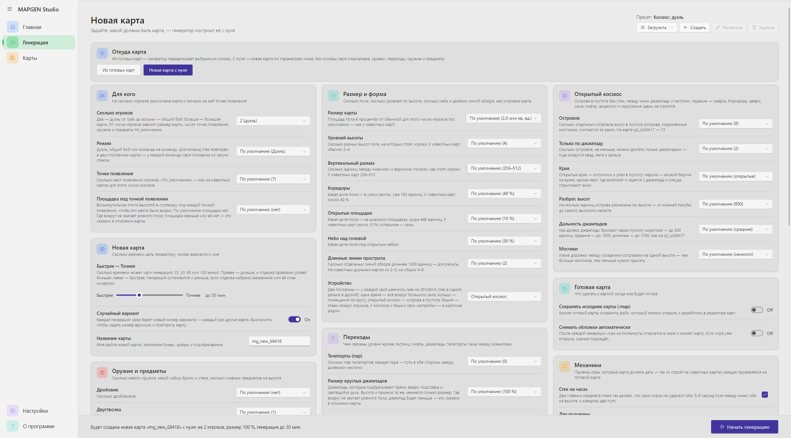

Вверху страницы «Генерация» — карточка **Откуда карта** с двумя кнопками: «Из готовых карт» (всё, что описано выше) и
«Новая карта с нуля». С нуля генератор не берёт ничьей карты: он сам строит каркас — помещения, уровни высоты, переходы
между ними, места оружия, брони и точек появления — по правилам известных карт, затем
собирает из каркаса настоящую карту, отделывает её своими правками и проверяет.

Проще всего начать с пресета: «Загрузить» → категория (дуэли, общий бой, большие карты, команда на команду, миры,
вода и лава, оружие, переходы, механики, вид, открытый космос, башня — всего 184 заводских пресета) → пресет; дальше —
«Начать генерацию». Любой параметр пресета можно поменять перед запуском.

Параметры разложены по карточкам. В каждом списке первым стоит «По умолчанию» — значение, которое генератор выберет
сам по числу игроков; какое именно, написано в скобках.

- **Для кого** — сколько игроков (2 — дуэль, от трёх до восьми — общий бой, больше — большая карта), режим (дуэль,
  общий бой, команда на команду — для команд стек повторён в двух половинах карты), сколько точек появления.
- **Размер и форма** — размер карты (площадь пола в процентах от обычной для этого числа игроков), уровней высоты,
  вертикальный размах, доля коридоров и открытых площадок, небо над головой, длинные линии прострела, **устройство**
  и **скругления** (скруглённые углы, полукруглые торцы залов, возвышения — как на medusa_b1). Устройства:
  - **две половины** — у каждой своя ценность (стек в одной, рельса в другой);
  - **одна арена** — всё вокруг большого зала;
  - **кольцо** — помещения по кругу;
  - **открытый космос** — острова висят в пустоте без стен, между ними джампады, мостики и телепорты; сорвался с
    края — погиб;
  - **башня** — целые этажи друг над другом вокруг атриума под небом: наверх джампадами и шахтами, вниз можно
    спрыгнуть, над верхним этажом площадки, куда попадают только джампадом.
- **Открытый космос** и **Башня** — у этих устройств своя карточка рядом с «Размером и формой». У космоса: сколько
  островов, сколько из них достаются только джампадом, края открытые или с перилами, разброс высот, дальность
  джампадов, мостики. У башни: сколько этажей, высота этажа, сколько шахт, сколько площадок наверху. Того, чего у
  них не бывает, форма для них не показывает: у космоса нет жидкостей, ям, скруглений, лестниц, лифтов, дверей, окон
  и украшений на стенах — только телепорты из переходов; у башни нет жидкостей, ям, скруглений, лестниц, лифтов,
  дверей и окон. Если такое заказано старым пресетом, генератор этого не строит и пишет об этом в описании карты.
- **Новая карта** и **Готовая карта** — время генерации, номер варианта и имя; сохранять ли исходник и снимать ли
  обложки. **«Случайный вариант»** (включён по умолчанию) — каждая генерация сама берёт новый номер, и каждый раз
  получается другая карта; номер виден в имени карты. Чтобы повторить карту, выключите переключатель и введите номер:
  одинаковые параметры и номер дают одну и ту же карту.
- **Жидкости** — доли пола под водой, лавой и кислотой и смертельные ямы. Вода лежит только в углублениях, из каждого
  есть ступени наверх. Флажок «Разрешить воде возвышаться над полом» (выключен) разрешает затапливать комнаты поверх
  пола, когда воды заказано больше, чем вмещают ямы; без него недостача названа в описании.
- **Переходы** — лестницы, пандусы, лифты, джампады, телепорты, лестницы-стремянки, спуски, двери и окна между
  комнатами. Джампады и телепорты выглядят как на известных картах: для прыжка вверх — светящийся диск на подставке, для
  полёта вдаль — наклонная плита со стрелками, над которой бегут стрелки в сторону полёта; телепорт стоит в раме из
  двух стоек с мерцающим порталом.
- **Механики** — приёмы игры с известных карт: стек на часах, две половины, пушка на уступе, асимметрия маршрута,
  много мелких аптечек, давление на спавны, тупик со стеком, три подхода, телепорт к зеркальному стеку, джампад над
  пропастью, лифт как уязвимость, стремянка под предметом. Каждую включённую механику проверка ищет на готовой карте.
- **Оружие и предметы** — сколько какого оружия, броня и стек (готовые наборы или свой), осколки брони, патроны и
  аптечки на игрока, доля главных предметов на высоте. **Доступность главных предметов**: просто — на постаменте под
  своим светом; средне — в нише в стене, через раз приподнятой над полом (запрыгнуть); сложно — в нише за дверью,
  которую открывает кнопка на стене; смешанно. **«Броня и мега по очереди в одной нише»** — красная броня и мега
  появляются по очереди в одном месте, как на q2dm8.
- **Стиль** — **текстуры**: «Как у известных карт» (по умолчанию: генератор берёт одну из карт q2dm, q2duel, ztn2dm,
  koldduel1, omf, ptrip, match1, kaktus и одевает карту в её текстуры стен, пола и потолка, её бордюры, лампы и цветной
  свет), «По выбранным картам» (кнопка со списком всех карт игры, поиском и галочками; берётся только отделка, без их
  стен и комнат), «Смешанно» или «Сгенерированные студией» — студия сама рисует набор текстур в выбранной теме
  (техника, готика, завод, бункер, снег и лёд, лес, город, другая планета, фэнтези, пустыня, ад), с цветом, износом,
  размером деталей и рельефом. Дальше — украшения на стенах, солнце, цвет света, **«Корабли в небе»** (до трёх
  кораблей из одиночной игры пролетают над картой) и отделка правками — насколько генератор меняет собранную из
  каркаса карту своими правками.
- **Разрушения** — как и для карты из готовой.

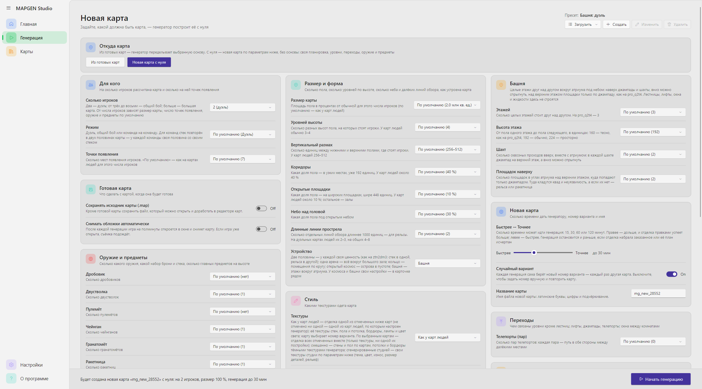

Пока идёт генерация, первым этапом на её странице стоит **Каркас карты**: из многих вариантов выбирается лучший по
меркам известных карт, и его картинка — места, уровни (чем светлее, тем выше), переходы, оружие и предметы — появляется
ещё до первой стены. Над всем этим — **Ход работы**: процент всей постройки, сколько осталось и когда закончится, какой
этап идёт («Этап 5 из 11: Правки»).

Большая карта с нуля — например, открытый космос на восемь игроков с большой площадью — ставится в середину мира
Quake II, а не в одну его половину, поэтому собирается, сколько бы места ни заняли острова.

Готовая карта проходит те же проверки, что и карта из готовой, и ещё две:

- **Карта с нуля** — она измерена так же, как известные карты (размер, уровни, ширина проходов, видимость, выходы у мест
  с предметами, свет, цвет и яркость текстур, для космоса — острова и полёты джампадов), и в ней есть всё, что заказано
  параметрами и механиками. На ней нет мест, куда можно попасть и откуда нельзя выбраться; лифты ездят только по
  воздуху; точки появления не стоят у телепортов и джампадов; вода не стоит над полом. Проверка идёт по карте, какой
  она попала в библиотеку, — уже после разрушений и света. Свет, с которым карту построили, остаётся до конца.
- **Не копия** — в ней нет комнат, кусков маршрута и расстановки предметов, перенесённых из карт, которые знает
  генератор.

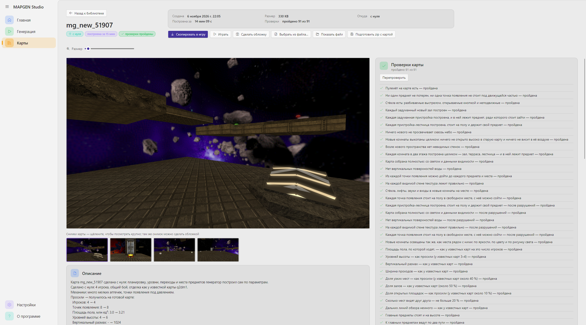

Описание карты с нуля начинается с строки «Сделано с нуля: 4 игрока, общий бой, отделка как у известной карты q2dm1» и
таблицы «Просили → получилось на готовой карте» по каждому параметру; дальше механики, а всё, что не получилось,
названо словами с причиной. На плитке и в карточке такая карта подписана «с нуля» (и стилем, если он взят по картам).

## Ход генерации

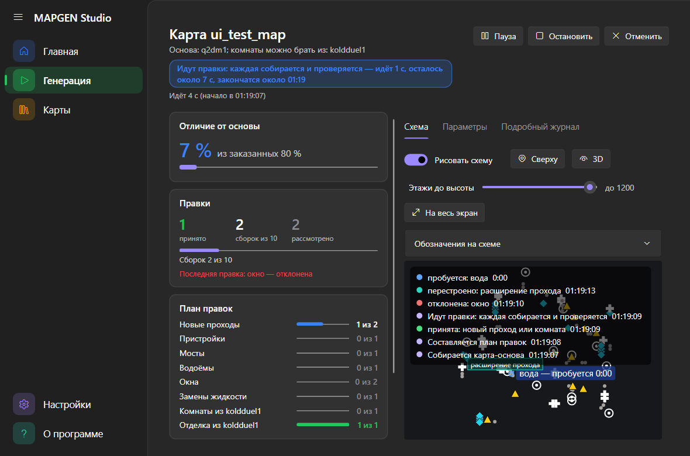

Страница разделена на две части: слева главное о ходе генерации, справа схема карты на всю высоту окна.

**Вверху** — название карты и основа, из которой она делается. Под ними цветная плашка с тем, что идёт сейчас, и
с его временем: синяя — генерация идёт, жёлтая — пауза, зелёная — карта готова, красная — генерация не удалась.
Рядом — сколько генерация уже идёт и когда началась. Справа — кнопки.

**Слева**, всегда открыто:

- **Ход работы** (у карты с нуля) — процент всей постройки, сколько осталось и когда закончится, какой этап идёт.
- **Отличие от основы** (у карты из готовой) — крупно, на сколько процентов карта уже отличается от основы, из скольких заказанных, и
  полоска. Под ней — что обещает план правок: насколько он может изменить карту за отведённые сборки.
- **Правки** — три числа: сколько правок принято (зелёное), сколько сборок сделано и сколько правок рассмотрено.
  Под ними полоска времени генерации, а ниже — последняя правка: зелёная, если принята, красная, если отклонена.
  После правок генератор меняет жидкости, переставляет предметы и пробует комнаты других карт — это тоже видно
  здесь («N из M»).
- **План правок** — таблица: что задумано по видам (новые проходы, пристройки, комнаты в два этажа, мосты,
  водоёмы, окна, пристройки-лестницы, перестройки основы, комнаты из второй карты и другие) — с полоской и
  счётом «сделано из задуманного». Готовый вид становится зелёным. Разрушения делаются после правок и проверок —
  их процент назван под таблицей.

**Слева**, в свёрнутых разделах (щелчок по заголовку открывает и закрывает):

- **Этапы** — Подготовка → Сборка карты-основы → Составление плана правок → Правки → Проверка проходимости →
  Свет и видимость → Проверки карты → (Разрушения — если они заданы) → Свет на готовой карте → Обложка → Готово.
  У идущего этапа видно время, у законченного — сколько шёл и когда закончился. Текущий этап назван и в заголовке
  раздела, когда он свёрнут.
- **Загрузка компьютера** — процессор, память, видеокарта, видеопамять: всей машины и отдельно генератора. В
  заголовке раздела — какая доля процессора отдана генерации.

**Справа** — три вкладки, схема занимает всё место справа:

- **Схема** — план карты сверху или под наклоном, на котором видны правки (и пристройки-лестницы, и, на стадии
  разрушений, каждая воронка, пролом, обвал и куча обломков по мере постройки) и, на стадии света, как
  освещается карта. Кнопки над схемой: рисовать ли её, вид сверху, вид в объёме, этажи до какой высоты показывать,
  и «На весь экран» — схема разворачивается на весь экран, а окно программы прячется. Раздел **«Обозначения на
  схеме»** (свёрнут) объясняет значки ровной таблицей: правки (пробуется, отклонена, принята, изменена основа),
  что ещё в плане, цвета карты (пол, вода, лава, слизь, лифты и двери) и предметы (оружие, броня, аптечки,
  патроны, усилители, места появления, телепорты). Если навести мышь на значок, всплывёт подробность, например
  «отклонённая правка — красная, гаснет за 10 секунд». Там же — как управлять схемой мышью.
- **Параметры** — с какими параметрами запущена генерация, в тех же карточках, что на странице генерации, только для
  просмотра.
- **Подробный журнал** — строки, которые пишет генератор.

**Этапы на схеме.** Каждый этап виден на самой схеме:

- **Изменение каркаса основы** — схема показывает саму основу, которая плавно растягивается в новую форму и
  возвращается обратно, пока генератор пробует каркас. Части основы подкрашены разными цветами, оранжевые линии —
  границы частей, значки предметов едут вместе с картой. Вверху справа подпись: размер и разброс частей.
- **Свет и видимость — видимость.** Видны проёмы между частями карты: голубые ещё не просчитаны, зелёные
  просчитаны. Волна расчёта расходится от места появления; по её фронту ходит «глаз» с голубыми лучами взгляда к
  следующим проверяемым проёмам, только что просчитанные отмечаются расходящимися кольцами. В подписи — сколько
  проёмов просчитано из скольких. Лучше смотреть в виде «3D»: сверху многие проёмы стоят ребром.
- **Свет и видимость — свет.** У каждого фонаря карты свечение его цвета; от фонарей расходятся лучи, разрастаясь
  по мере расчёта прямого света, а на отражённом свете свечение пульсирует. Прожекторы показывают, куда светят.
  В подписи — сколько фонарей и сколько процентов просчитано.

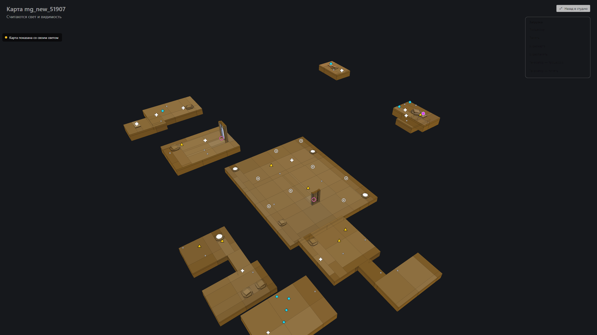

На развёрнутой схеме кнопка «Назад в студию» (или клавиша Esc) закрывает её и возвращает окно программы.

Кнопки вверху справа:

- **Пауза** / **Продолжить** — генератор останавливается на месте и продолжает с него же.
- **Остановить** — генерация прерывается; её можно продолжить позже с того же места со страницы «Генерация»
  (там появляется карточка «Прерванная генерация» с кнопками «Продолжить» и «Удалить»), если в настройках включено
  «Сохранять принятые шаги на диск».
- **Отменить** — генерация останавливается, и все её рабочие файлы удаляются.

Когда карта готова, программа сообщает об этом и кладёт карту в библиотеку; в сообщении — сколько проверок пройдено.
Предупреждением сообщение становится, только если в карту нельзя играть (см. «Библиотека карт»).

### Если генератор отказался

Первым делом генератор переводит карту-основу обратно в исходник и собирает заново, чтобы потом менять копию.
Если копия разошлась с оригиналом, он не трогает такую карту и пишет, в чём именно разошлось: например, «что
нарисовано на стенах» — и точные слова генератора ниже. То же попадает в журнал.

## Библиотека карт

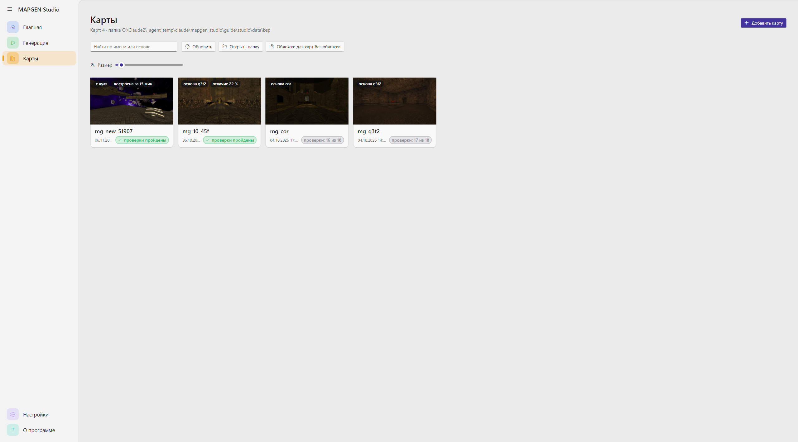

Раздел «Карты» показывает все готовые карты плитками. На обложке — основа карты и её отличие от основы (у карты с нуля
— «с нуля»); под обложкой — название, когда сделана, размер и итог проверок:

- зелёный **«проверки пройдены»** — пройдено всё;
- серый **«проверки: 89 из 93»** — что-то не прошло, но в карту можно играть: обычно это меры вкуса (доля коридоров,
  цвет текстур, число линий прострела) или задуманная правка, которую генератор не смог построить;
- красный **«играть нельзя: N»** — только когда не прошла проверка, без которой играть нельзя: точка появления в стене
  или с неё не сойти, предмет потерян или точка появления под движущейся частью, есть место, откуда не выбраться, до
  главного предмета не дойти, точек появления меньше заказанного.

Поле «Найти по имени или основе» оставляет только подходящие карты. Размер плиток меняется ползунком «Размер» или
колёсиком мыши с зажатым Ctrl. «Добавить карту» (вверху справа) берёт в библиотеку любую карту с диска; «Обновить»
перечитывает папку; «Открыть папку» открывает её в проводнике.

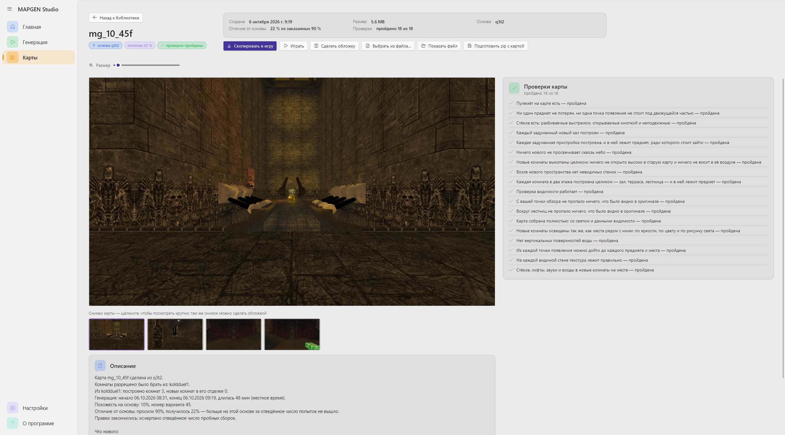

Щелчок по плитке открывает карту. Вверху — её название и те же отметки (основа, отличие, проверки); на широком окне
рядом с названием — сведения (создана, размер, основа, отличие от основы или время постройки, сколько проверок
пройдено) и кнопки. Ниже слева — обложка во всю колонку, под ней снимки и описание; справа, вровень с обложкой, —
проверки. На узком окне всё идёт одной колонкой.

- **Описание** — из какой основы сделана (или что просили и что получилось у карты с нуля), какие карты давали
  комнаты, похожесть и номер варианта, что нового построено, сколько длилась генерация.
- **Проверки карты** — в заголовке счёт «пройдено N из M»; непройденные стоят первыми, и под каждой — что намерено
  и сколько должно быть, словами: например, «пол пересвечен 2.0 % (у известных карт не больше 1 %)». Проверка, без которой
  играть нельзя, помечена «— играть нельзя».
- **Перепроверить** (у карты с нуля) — заново измеряет готовую карту проверками этой версии студии: минута-две, без
  генерации. Проверки самого генератора остаются как были.
- **Снимки карты** — щелчок открывает снимок крупно; стрелками листаются остальные, Esc закрывает; любой снимок
  можно сделать обложкой. «Сделать обложку» запускает игру на карте, снимает несколько видов и закрывает её;
  «Выбрать из файла…» берёт обложку из своей картинки. Обложки карты с нуля показывают её джампад и телепорт, если они
  на ней есть.
- **Играть** — запускает игру на этой карте. Ваши настройки игры не меняются.
- **Скопировать в игру** — кладёт карту в папку карт вашего клиента.
- **Показать файл** и **Подготовить zip с картой** — архив для сервера: папки `baseq2/maps` и `baseq2/textures`, всё,
  что карте нужно.

## Настройки

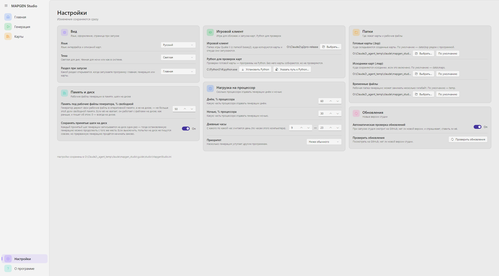

Настройки разложены по карточкам в колонки по ширине окна (до трёх): Вид, Игровой клиент, Папки, Нагрузка на
процессор, Память и диск, Обновления. Каждая настройка — строка: слева что она делает, справа сама настройка.

- **Вид**: язык (русский или английский), тема (как в системе, светлая, тёмная), «Раздел при запуске».
- **Папки**: готовые карты, исходники карт, временные файлы. Любую можно сменить или вернуть «По умолчанию».
- **Игровой клиент** — папка с игрой, в которой есть `baseq2`.
- **Python для проверок карт** — какой Python использует программа; здесь же его можно установить или указать.
- **Нагрузка на процессор** — какую долю процессора отдавать генератору днём и ночью, и какие часы считать
  дневными. Генератор никогда не берёт больше; остальное остаётся вам.
- **Память и диск** — сколько свободной памяти можно занять рабочими файлами генератора (тогда диск почти не
  используется) и сохранять ли принятые шаги на диск — без этого прерванную генерацию нельзя продолжить.
- **Обновления** — «Автоматическая проверка обновлений» (включена) и кнопка «Проверить обновления». Если на GitHub
  есть новая версия, программа покажет её номер и все изменения (новые — сверху) и спросит: «Да» — скачать,
  проверить и поставить (ваши карты и настройки остаются; программа перезапустится и покажет окно «Что нового»),
  «Отмена» — не сейчас, при следующем запуске она спросит снова.

Настройки сохраняются в файл рядом с программой; где именно — написано внизу страницы. Там же окно запоминает свой
размер и место: открывается там, где его закрыли, а при первом запуске на широком экране — во весь экран.

## О программе

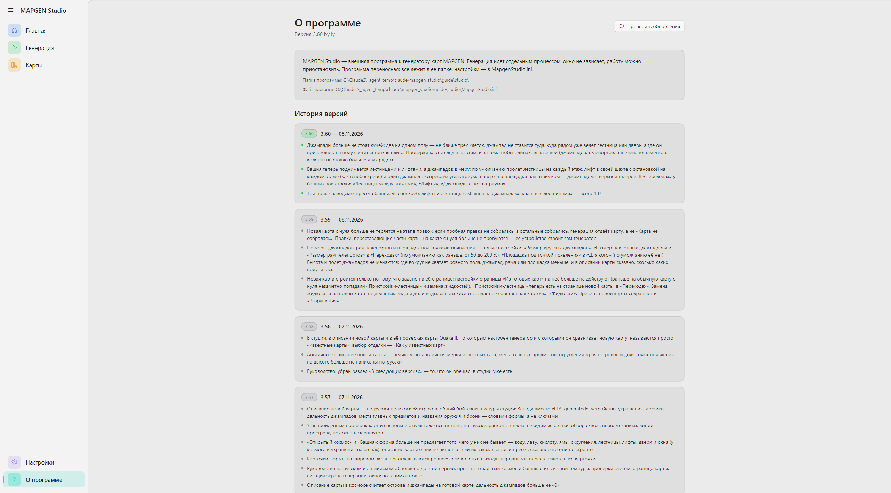

Версия программы и кнопка «Проверить обновления» (вверху справа), что это за программа, где лежат она и файл
настроек; ниже — история версий карточками: что менялось в каждой, самая новая сверху и выделена.

## Если что-то не так

- **«Игровой клиент не выбран»** — укажите в настройках папку с игрой; в ней должна быть папка `baseq2`.
- **«Генератор не найден»** — рядом с программой нет папки `engine`. Распакуйте сборку заново целиком.
- **«Проверки карты пропущены: не найден Python»** — нажмите «Установить Python» на главной странице или в
  настройках (или «Указать путь к Python…», если он уже стоит) и запустите генерацию снова; карта от этого не
  меняется, только появляются проверки.
- **«Карта не получилась: генератор не смог точно пересобрать эту карту-основу»** — в сообщении написано, в чём
  копия разошлась с оригиналом. Такую карту пока нельзя брать основой; попробуйте другую.
- **Генерация прервалась** — на странице «Генерация» есть карточка прерванной генерации с кнопкой
  «Продолжить».
- **Генератор упал** — программа покажет, где лежит запись о падении; её можно отправить разработчику, а
  генерацию продолжить с того же места.
- **У карты «проверки: 89 из 93»** — в неё можно играть; что не прошло и почему, написано на странице карты под каждой
  непройденной проверкой.
- **У карты «играть нельзя»** — на странице карты видно, какая проверка не прошла и где (например, точка появления
  стоит не на свободном месте). Такую карту лучше сделать заново с другим номером варианта.
- **Карта с нуля сделана старой версией студии** — кнопка «Перепроверить» на её странице измерит её проверками
  текущей версии.

## Где лежат файлы

- Готовые карты: папка «Готовые карты (.bsp)» из настроек; по умолчанию — `data\bsp` рядом с программой.
- Описания, обложки и снимки: `data\descriptions`, `data\covers` (снимки игры хранятся в JPEG — в десять раз меньше
  PNG при том же виде; снимки прежних версий студия пережимает сама после запуска). Маленькие копии обложек для
  плиток — в `temp\thumbs`, их можно удалить, студия сделает их заново.
- Рабочие файлы идущей генерации: папка «Временные файлы»; после готовой карты они удаляются, небольшой отчёт
  о генерации остаётся в `data\runs\<название карты>`.
- Настройки: `MapgenStudio.ini` рядом с программой.
