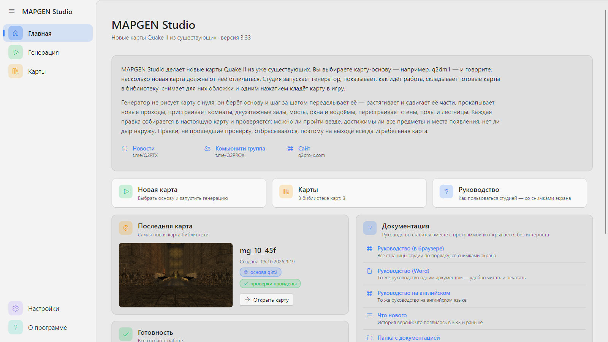
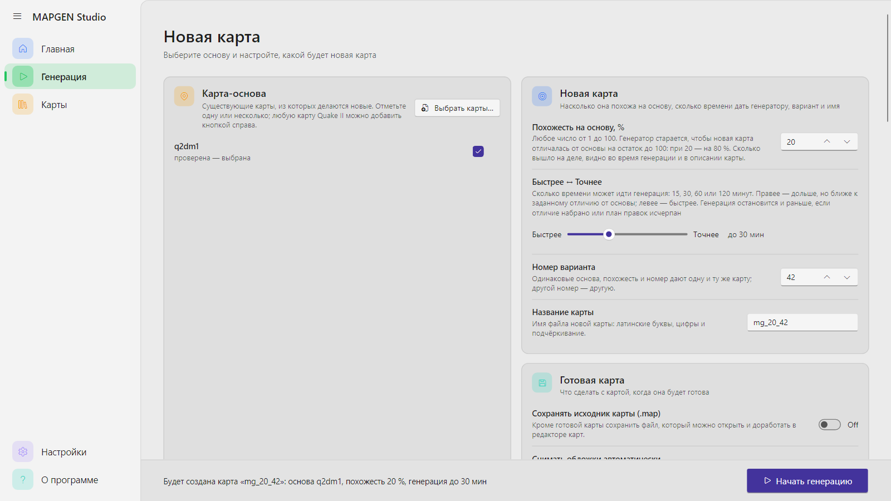
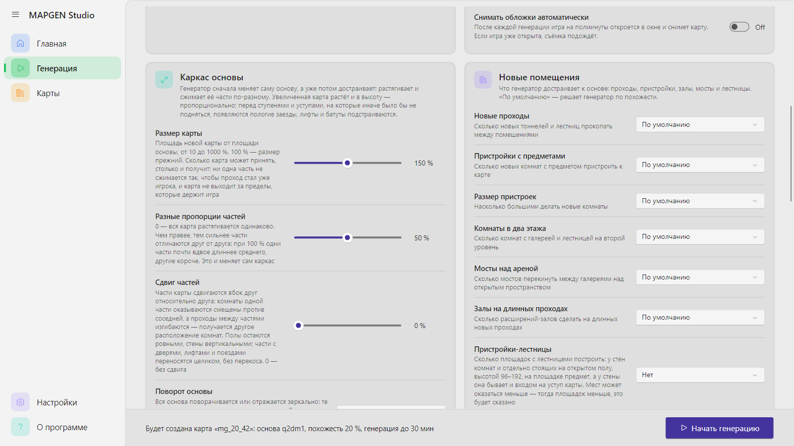
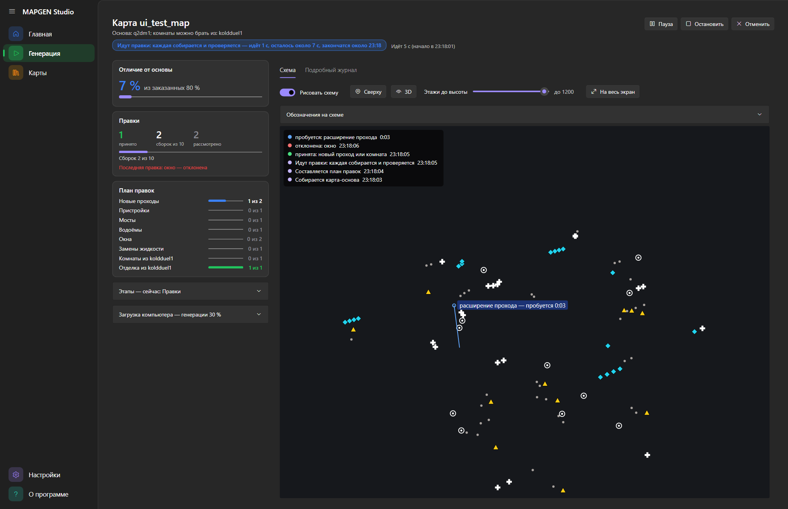
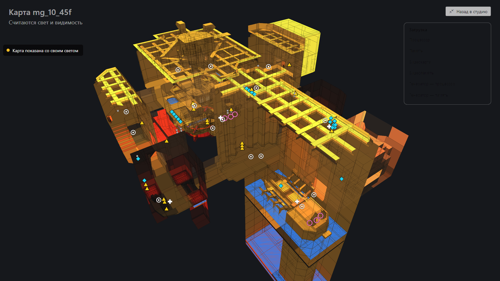
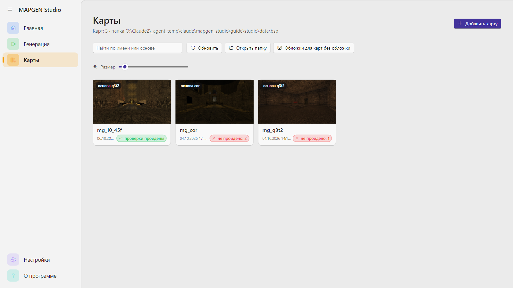
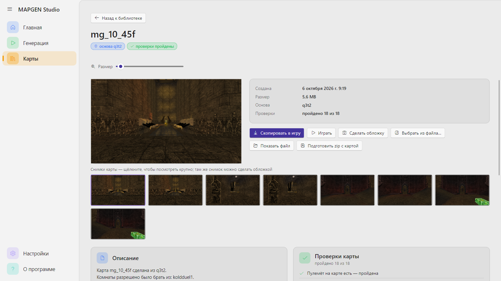
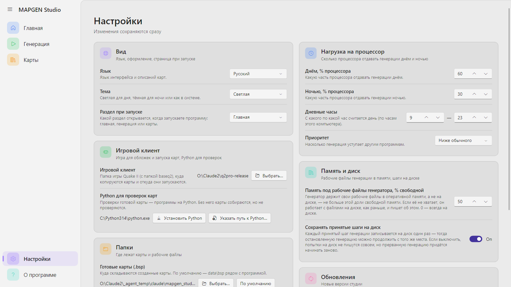
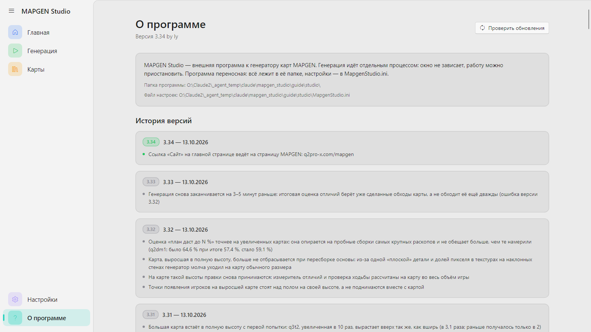

# MAPGEN Studio by ly — руководство

MAPGEN Studio переделывает готовую карту Quake II в новую: прокладывает проходы в скале, переносит комнаты из
другой карты, заливает низины водой, лавой или кислотой, меняет отделку, переставляет предметы — и проверяет,
что по новой карте можно пройти, что она освещена и что в ней ничего не сломано. Карта-основа при этом
остаётся на месте, новая карта кладётся рядом.

Сейчас программа делает новые карты из уже готовых. В будущих версиях появится и сборка новой карты с нуля,
без карты-основы; пока эта возможность не предоставляется.

Все снимки в этом руководстве сделаны самой программой из той версии, к которой оно приложено.

## Что нужно

- Windows 10 или 11, 64 бита.
- Quake II с папкой `baseq2` — любой клиент: из неё берутся текстуры, на ней же запускается игра для обложек.
- Python 3.10 или новее — для проверок готовой карты. Если его нет, программа сама предложит его установить
  (кнопка «Установить Python» скачает официальный установщик с python.org и поставит его только для вас, без прав
  администратора) или указать путь к уже установленному («Указать путь к Python…»). Без Python карта соберётся,
  но проверки будут пропущены.
- Карты-основы: программа не содержит карт. Любой файл карты Quake II (`.bsp`) из вашей игры можно добавить
  как основу прямо из программы.

## Первый запуск

Пока студия загружается, на экране окно загрузки: процент готовности и что делается сейчас (оформление окон,
чтение библиотеки карт, обложка последней карты, поиск Python и игры, загрузка студии). Процент считается по тому,
сколько каждый шаг занял при прошлом запуске, поэтому на медленном компьютере или диске полоска идёт так, как
загружается именно он. Первый запуск после установки дольше обычного.

Слева — меню: **Главная**, **Генерация**, **Карты**, внизу **Настройки** и **О программе**. У каждого раздела
свой цветной значок; раздел под мышью подсвечивается, открытый выделен своим цветом и полоской слева. Кнопка ☰
вверху сворачивает меню до одних значков и разворачивает обратно.

На главной странице:

- **Пара абзацев о студии и генераторе** — что они делают и почему на выходе всегда играбельная карта.
- **Ссылки сообщества** под ними: **Новости** (канал в Telegram, https://t.me/Q2RTX), **Комьюнити группа** (группа в
  Telegram, https://t.me/Q2PROX) и **Сайт** (http://q2pro-x.com/mapgen); открываются в браузере.
- **Три большие кнопки**: «Новая карта» — к генерации, «Карты» — к библиотеке (на кнопке видно, сколько в ней
  карт), «Руководство» — открывает это руководство.
- **Последняя карта** — самая новая карта библиотеки: обложка, основа, итог проверок и кнопка «Открыть карту».
  Пока идёт генерация, здесь вместо неё — что делается сейчас и кнопка «Открыть генерацию».
- **Готовность** — всё ли настроено: игровой клиент (папка с игрой, где лежит `baseq2`), генератор (папка `engine`
  рядом с программой; если её нет, сборка повреждена), Python и проверки готовых карт. Если чего-то не хватает, тут же
  кнопка, чтобы это исправить: «Открыть настройки», «Установить Python», «Указать путь к Python…».
- **Документация** — руководство ставится вместе с программой (папка `doc` рядом с ней) и открывается без
  интернета: в браузере, в Word, на английском; «Что нового» — история версий; «Папка с документацией».
- **Как сделать карту** — четыре шага.

**Строка генерации.** Пока идёт генерация, над любой страницей, кроме страницы самой генерации, видна строка:
название карты и основа, что делается сейчас и сколько осталось, отличие от основы, сколько правок принято и
сколько сборок сделано, полоска и кнопка «Открыть генерацию» (щелчок по строке делает то же). Когда генерация
закончится, строка остаётся, пока вы не заглянете на её страницу.

## Генерация

Страница разложена по карточкам в две колонки. Вверху слева — **Карта-основа**, справа от неё — **Новая карта**
(похожесть на основу, время генерации, номер варианта, название) и **Готовая карта** (сохранять ли исходник, снимать
ли обложки автоматически). Карточка основ той же высоты, что две карточки справа вместе; если карт в списке больше,
чем в ней помещается, список прокручивается внутри неё. Ниже — параметры генерации, карточками по группам, по две в
ряд одной высоты: **Каркас основы** и **Новые помещения**, **Переделка основы** и **Вода, кислота, лава**,
**Разрушения** и **Что можно менять**. Внизу страницы всегда видна строка «Будет создана карта … : основа …, похожесть …,
генерация до … мин» и кнопка **«Начать генерацию»** — где бы вы ни были на странице.

### Карта-основа

Отметьте одну или несколько карт. Кнопка «Выбрать карты…» добавляет любой файл карты Quake II с диска — он
копируется к программе и дальше всегда есть в списке. У каждой карты написано, проверена ли она уже
генератором или это первая проба.

Если отмечено несколько карт, выберите, что из них сделать:

- **По карте из каждой** — каждая отмеченная карта станет основой своей новой карты, по очереди.
- **Одну карту из нескольких** — первая отмеченная карта будет основой, а из остальных генератор берёт
  комнаты и переносит их в скалу целиком, со стенами, потолком, светильниками и украшениями.

### Похожесть на основу и номер варианта

- **Похожесть на основу, %** — насколько новая карта должна остаться похожей на старую. 90 — почти та же
  карта с небольшими правками; 10 — генератор меняет всё, что может. Любое число от 1 до 100.
- **Номер варианта** — число, от которого зависит, какие именно правки будут выбраны. Та же основа, та же
  похожесть и тот же номер дают ту же карту; другой номер — другую.
- **Название карты** — латинскими буквами и цифрами. Программа предлагает своё: `mg_` + похожесть +
  номер варианта.

### Каркас основы

Прежде чем что-то пристраивать, генератор может изменить саму основу:

- **Размер** — площадь новой карты от площади основы, от 10 до 1000 %. Увеличенная карта растёт и в высоту, сохраняя
  пропорции: залы становятся не только шире, но и выше. Перед ступенями и уступами, на которые иначе было бы не
  подняться, появляются пологие заезды или лесенки; щели в решётках, куда раньше нельзя было провалиться, перекрыты;
  лифты и батуты подстраиваются под новую высоту. Если при полном росте высоты где-то нельзя пройти, генератор
  пробует чуть меньший рост, пока карта не станет проходимой целиком. Уменьшенная карта высоту не теряет.
  Предметы и точки появления игроков остаются на своей высоте над полом. Свет на большой карте рассчитывается с
  шагом, подобранным под её размер, — карта, увеличенная в несколько раз, не выйдет тёмной.
- **Разброс** — насколько по-разному растягиваются части основы.
- **Сдвиг** — насколько части сдвигаются вбок друг относительно друга.
- **Поворот** — повернуть или отразить основу целиком.
- **Высота потолков** — сверх пропорциональной высоты: всё, что выше самого высокого места, где может стоять игрок,
  поднимается ещё. 100 % — пропорционально размеру карты. На очень большой карте потолкам может не хватить места —
  координаты игры ограничены; тогда они поднимаются настолько, насколько позволяет игра, и в журнале хода появляется
  строка вида «Потолки подняты до 134 % из заказанных 200 %: выше не позволяют координаты игры».

### Размах переделок

Сколько и чего строить, задают карточки под основой: **Новые помещения** (проходы, пристройки, залы, мосты,
лестницы), **Переделка основы** (стены, блоки, пол, лестницы, украшения), **Вода, кислота, лава** и **Разрушения**.
У каждой настройки есть значение «По умолчанию» — тогда решает генератор, исходя из похожести. Остальные
значения — ваш прямой заказ:

- **Новые проходы** — сколько новых тоннелей и лестниц пробить в скале между комнатами.
- **Пристройки с предметами** и **Размер пристроек** — сколько комнат-пристроек с оружием или бронёй добавить
  и какого размера (небольшие, средние, большие, залы).
- **Комнаты в два этажа** — сколько комнат получат галерею и лестницу на второй уровень.
- **Мосты над ареной** — сколько мостов перекинуть над открытым пространством.
- **Залы на длинных проходах**.
- **Жидкости** — заменить жидкости основы другими: воду лавой, лаву водой, кислоту лавой и так далее, или
  перемешать. Меняется и вид, и свойства: в лаве горят, в кислоте разъедает, в воде плавают.
- **Украшения на стенах** — генератор находит на стенах основы её светильники и повторяющиеся украшения и
  вешает такие же в своих тоннелях: без украшений, мало, много, очень много.
- **Новая вода**, **Новая кислота**, **Новая лава** — три ползунка. По умолчанию решает генератор; 0 — этой
  жидкости не добавлять совсем; 100 — залить ею все комнаты, где это можно. Генератор заливает только комнаты с
  ровным полом, под которым нет другой комнаты, и не отрезает ни предметы, ни проходы. Лаву и кислоту он не
  кладёт рядом с точками появления; проходы между комнатами заливает только водой.
- **Пристройки-лестницы** — от «Нет» до 10. Генератор строит новые площадки на высоте 96–192 с лестницей к ним:
  вдоль стен комнат и отдельно стоящие на открытом полу (таких не больше половины). На площадке оказывается предмет
  из этой части карты, а площадка у стены бывает и входом на уступ карты. Места он ищет на любой основе сам — нужен ровный пол, свободное место вокруг и над головой;
  если мест меньше, чем заказано, площадок будет меньше, и это сказано в описании карты.
- **Перестройка основы** — сколько раз изменить саму карту-основу, а не пристраивать к ней: стена комнаты
  сдвигается внутрь, стена поворачивается под углом, вдоль стены поднимается терраса со ступенями.
- **Блоки в комнатах** — сколько блоков поставить в комнатах основы: коробка, Г-образный, крест, восьмигранник
  или круглый, от 64 до 192 в поперечнике, повёрнутые на разные углы. Низкие (32–64) — чтобы запрыгнуть, высокие
  (96–128) — укрытие; у стены или отдельно, из материала самой комнаты.
- **Пол: помосты и каналы** — сколько раз изменить пол основы: поднять помост со ступенями со всех сторон
  (коробка или восьмигранник, высотой 32–80) или опустить канал поперёк пола (глубиной 32–64) с лестницами на
  обоих концах. Канал копается только там, где под полом нет другого помещения; в первую очередь — на арене.
- **Переделка лестниц основы** — сколько лестниц основы перестроить другой формой между теми же двумя полами:
  старый марш становится площадкой, а подниматься на неё — по полукруглым ступеням у подножия или по боковому
  маршу. Нужен свободный ровный пол перед лестницей.

  У всех четырёх «По умолчанию» — решает генератор по похожести (чем меньше похожесть, тем больше переделок).
  Если подходящих мест меньше, чем заказано, сделано будет меньше, и это сказано в описании карты.
- **Разрушения** — ползунок от 0 до 100 %. При 0 карта собирается как обычно, со всеми проверками проходимости.
  Чем больше значение, тем больше разрушено: трещины на стенах и полу, кучи обломков, воронки, проломы в стенах,
  отбитые края уступов, обвалы потолка, завалы в коридорах; при 100 — почти весь уровень. Точки появления всегда
  остаются свободными, предметы не засыпаются; а вот проходимость при разрушениях не гарантируется. Для разрушений
  генератор берёт свой набор текстур (земля, камень, бетон, кирпич, металл, щебень и другие) и подбирает их под
  цвета самой карты; набор кладётся в папку игры вместе с картой.

Карточка «Что можно менять» перечисляет семейства правок; любое можно выключить галочкой.

В карточке «Готовая карта»: «Сохранять исходник карты (.map)» оставляет рядом с готовой картой её исходник для
редактора карт; «Снимать обложки автоматически» — после каждой готовой карты программа сама запускает игру и делает
обложку.

Окна генератор прорезает сам, столько, сколько позволяет похожесть: неподвижное стекло, стекло, которое падает от
выстрела и через некоторое время возвращается, и стекло, которое открывает нажимная плита на полу. Окна бывают
разной формы — прямоугольные, круглые или овальные, арочные, с переплётом и форточкой — и с разным стеклом:
светлым, синим, голубоватым и серым армированным, янтарным, оливковым, дымчатым.

Кнопка «Начать генерацию» запускает работу. Если имя карты уже занято — в библиотеке есть карта с таким именем,
остались записи прошлой генерации, такая генерация идёт, стоит в очереди или прервана, — программа сначала
спрашивает: **Перезаписать** (новая карта заменит старую вместе с её записями), **Исправить имя** (страница
прокручивается к полю «Название карты», курсор уже в нём) или **Отменить**. Идущую генерацию перезаписать нельзя — только
исправить имя или отменить.

## Ход генерации

Страница разделена на две части: слева главное о ходе генерации, справа схема карты на всю высоту окна.

**Вверху** — название карты и основа, из которой она делается. Под ними цветная плашка с тем, что идёт сейчас, и
с его временем: синяя — генерация идёт, жёлтая — пауза, зелёная — карта готова, красная — генерация не удалась.
Рядом — сколько генерация уже идёт и когда началась. Справа — кнопки.

**Слева**, всегда открыто:

- **Отличие от основы** — крупно, на сколько процентов карта уже отличается от основы, из скольких заказанных, и
  полоска. Под ней — что обещает план правок: насколько он может изменить карту за отведённые сборки.
- **Правки** — три числа: сколько правок принято (зелёное), сколько сборок сделано и сколько правок рассмотрено.
  Под ними полоска времени генерации, а ниже — последняя правка: зелёная, если принята, красная, если отклонена.
  После правок генератор меняет жидкости, переставляет предметы и пробует комнаты других карт — это тоже видно
  здесь («N из M»).
- **План правок** — таблица: что задумано по видам (новые проходы, пристройки, комнаты в два этажа, мосты,
  водоёмы, окна, пристройки-лестницы, перестройки основы, комнаты из второй карты и другие) — с полоской и
  счётом «сделано из задуманного». Готовый вид становится зелёным. Разрушения делаются после правок и проверок —
  их процент назван под таблицей.

**Слева**, в свёрнутых разделах (щелчок по заголовку открывает и закрывает):

- **Этапы** — Подготовка → Сборка карты-основы → Составление плана правок → Правки → Проверка проходимости →
  Свет и видимость → Проверки карты → (Разрушения — если они заданы) → Свет на готовой карте → Обложка → Готово.
  У идущего этапа видно время, у законченного — сколько шёл и когда закончился. Текущий этап назван и в заголовке
  раздела, когда он свёрнут.
- **Загрузка компьютера** — процессор, память, видеокарта, видеопамять: всей машины и отдельно генератора. В
  заголовке раздела — какая доля процессора отдана генерации.

**Справа** — две вкладки:

- **Схема** — план карты сверху или под наклоном, на котором видны правки (и пристройки-лестницы, и, на стадии
  разрушений, каждая воронка, пролом, обвал и куча обломков по мере постройки) и, на стадии света, как
  освещается карта. Кнопки над схемой: рисовать ли её, вид сверху, вид в объёме, этажи до какой высоты показывать,
  и «На весь экран» — схема разворачивается на весь экран, а окно программы прячется. Раздел **«Обозначения на
  схеме»** (свёрнут) объясняет значки ровной таблицей: правки (пробуется, отклонена, принята, изменена основа),
  что ещё в плане, цвета карты (пол, вода, лава, слизь, лифты и двери) и предметы (оружие, броня, аптечки,
  патроны, усилители, места появления, телепорты). Если навести мышь на значок, всплывёт подробность, например
  «отклонённая правка — красная, гаснет за 10 секунд». Там же — как управлять схемой мышью.
- **Подробный журнал** — строки, которые пишет генератор.

**Этапы на схеме.** Каждый этап виден на самой схеме:

- **Изменение каркаса основы** — схема показывает саму основу, которая плавно растягивается в новую форму и
  возвращается обратно, пока генератор пробует каркас. Части основы подкрашены разными цветами, оранжевые линии —
  границы частей, значки предметов едут вместе с картой. Вверху справа подпись: размер и разброс частей.
- **Свет и видимость — видимость.** Видны проёмы между частями карты: голубые ещё не просчитаны, зелёные
  просчитаны. Волна расчёта расходится от места появления; по её фронту ходит «глаз» с голубыми лучами взгляда к
  следующим проверяемым проёмам, только что просчитанные отмечаются расходящимися кольцами. В подписи — сколько
  проёмов просчитано из скольких. Лучше смотреть в виде «3D»: сверху многие проёмы стоят ребром.
- **Свет и видимость — свет.** У каждого фонаря карты свечение его цвета; от фонарей расходятся лучи, разрастаясь
  по мере расчёта прямого света, а на отражённом свете свечение пульсирует. Прожекторы показывают, куда светят.
  В подписи — сколько фонарей и сколько процентов просчитано.

На развёрнутой схеме кнопка «Назад в студию» (или клавиша Esc) закрывает её и возвращает окно программы.

Кнопки вверху справа:

- **Пауза** / **Продолжить** — генератор останавливается на месте и продолжает с него же.
- **Остановить** — генерация прерывается; её можно продолжить позже с того же места со страницы «Генерация»
  (там появляется карточка «Прерванная генерация» с кнопками «Продолжить» и «Удалить»), если в настройках включено
  «Сохранять принятые шаги на диск».
- **Отменить** — генерация останавливается, и все её рабочие файлы удаляются.

Когда карта готова, программа сообщает об этом и кладёт карту в библиотеку. Если проверки карты не пройдены,
это тоже написано — с подробностями в описании карты.

### Если генератор отказался

Первым делом генератор переводит карту-основу обратно в исходник и собирает заново, чтобы потом менять копию.
Если копия разошлась с оригиналом, он не трогает такую карту и пишет, в чём именно разошлось: например, «что
нарисовано на стенах» — и точные слова генератора ниже. То же попадает в журнал.

## Библиотека карт

Раздел «Карты» показывает все готовые карты плитками. На обложке — основа карты и её отличие от основы; под
обложкой — название, когда сделана, размер и итог проверок: зелёный «проверки пройдены» или красный «не пройдено:
N». Поле «Найти по имени или основе» оставляет только подходящие карты. Размер плиток меняется ползунком «Размер»
или колёсиком мыши с зажатым Ctrl. «Добавить карту» (вверху справа) берёт в библиотеку любую карту с диска;
«Обновить» перечитывает папку; «Открыть папку» открывает её в проводнике.

Щелчок по плитке открывает карту. Вверху — её название и те же отметки (основа, отличие, проверки); справа от
обложки — сведения (создана, размер, основа, отличие от основы, сколько проверок пройдено) и кнопки; ниже — описание
и проверки в двух карточках:

- **Описание** — из какой основы сделана, какие карты давали комнаты, похожесть и номер варианта, что нового
  построено, сколько длилась генерация.
- **Проверки карты** — каждая проверка с отметкой «пройдена» / «НЕ пройдена» и объяснением простыми словами.
- **Снимки карты** — щелчок открывает снимок крупно; стрелками листаются остальные, Esc закрывает; любой снимок
  можно сделать обложкой. «Сделать обложку» запускает игру на карте, снимает несколько видов и закрывает её;
  «Выбрать из файла…» берёт обложку из своей картинки.
- **Играть** — запускает игру на этой карте. Ваши настройки игры не меняются.
- **Скопировать в игру** — кладёт карту в папку карт вашего клиента.

## Настройки

Настройки разложены по карточкам в две колонки: Вид, Игровой клиент, Папки, Нагрузка на процессор, Память и
диск, Обновления. Каждая настройка — строка: слева что она делает, справа сама настройка.

- **Вид**: язык (русский или английский), тема (как в системе, светлая, тёмная), «Раздел при запуске».
- **Папки**: готовые карты, исходники карт, временные файлы. Любую можно сменить или вернуть «По умолчанию».
- **Игровой клиент** — папка с игрой, в которой есть `baseq2`.
- **Python для проверок карт** — какой Python использует программа; здесь же его можно установить или указать.
- **Нагрузка на процессор** — какую долю процессора отдавать генератору днём и ночью, и какие часы считать
  дневными. Генератор никогда не берёт больше; остальное остаётся вам.
- **Память и диск** — сколько свободной памяти можно занять рабочими файлами генератора (тогда диск почти не
  используется) и сохранять ли принятые шаги на диск — без этого прерванную генерацию нельзя продолжить.
- **Обновления** — «Автоматическая проверка обновлений» (включена) и кнопка «Проверить обновления». Если на GitHub
  есть новая версия, программа покажет её номер и все изменения (новые — сверху) и спросит: «Да» — скачать,
  проверить и поставить (ваши карты и настройки остаются; программа перезапустится и покажет окно «Что нового»),
  «Отмена» — не сейчас, при следующем запуске она спросит снова.

Настройки сохраняются в файл рядом с программой; где именно — написано внизу страницы.

## О программе

Версия программы и кнопка «Проверить обновления» (вверху справа), что это за программа, где лежат она и файл
настроек; ниже — история версий карточками: что менялось в каждой, самая новая сверху и выделена.

## Если что-то не так

- **«Игровой клиент не выбран»** — укажите в настройках папку с игрой; в ней должна быть папка `baseq2`.
- **«Генератор не найден»** — рядом с программой нет папки `engine`. Распакуйте сборку заново целиком.
- **«Проверки карты пропущены: не найден Python»** — нажмите «Установить Python» на главной странице или в
  настройках (или «Указать путь к Python…», если он уже стоит) и запустите генерацию снова; карта от этого не
  меняется, только появляются проверки.
- **«Карта не получилась: генератор не смог точно пересобрать эту карту-основу»** — в сообщении написано, в чём
  копия разошлась с оригиналом. Такую карту пока нельзя брать основой; попробуйте другую.
- **Генерация прервалась** — на странице «Генерация» есть карточка прерванной генерации с кнопкой
  «Продолжить».
- **Генератор упал** — программа покажет, где лежит запись о падении; её можно отправить разработчику, а
  генерацию продолжить с того же места.

## В следующих версиях

- **Сборка карты с нуля** — новая карта без карты-основы. Генератор это уже умеет в черновом виде, но в
  программе эта возможность пока не предоставляется: она появится, когда карты из готовых будут доведены до
  нужного качества.

## Где лежат файлы

- Готовые карты: папка «Готовые карты (.bsp)» из настроек; по умолчанию — `data\bsp` рядом с программой.
- Описания, обложки и снимки: `data\descriptions`, `data\covers` (снимки игры хранятся в JPEG — в десять раз меньше
  PNG при том же виде; снимки прежних версий студия пережимает сама после запуска). Маленькие копии обложек для
  плиток — в `temp\thumbs`, их можно удалить, студия сделает их заново.
- Рабочие файлы идущей генерации: папка «Временные файлы»; после готовой карты они удаляются, небольшой отчёт
  о генерации остаётся в `data\runs\<название карты>`.
- Настройки: `MapgenStudio.ini` рядом с программой.
